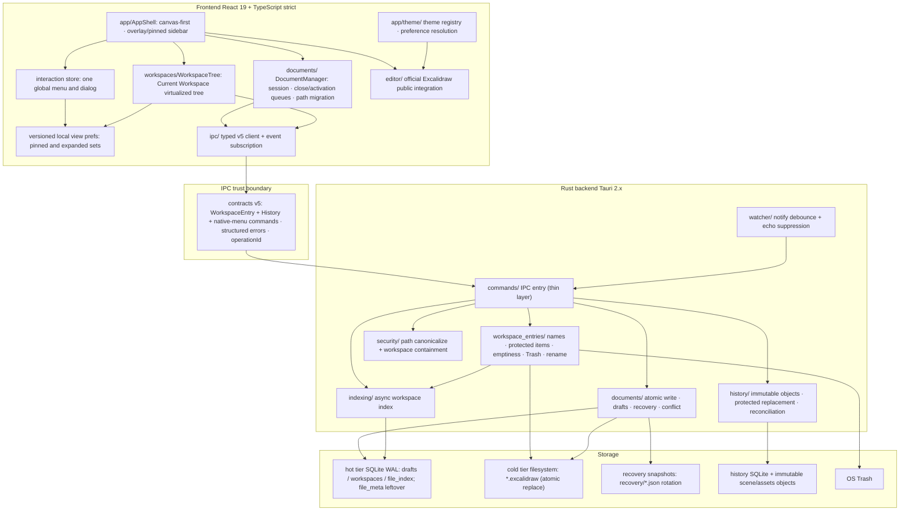
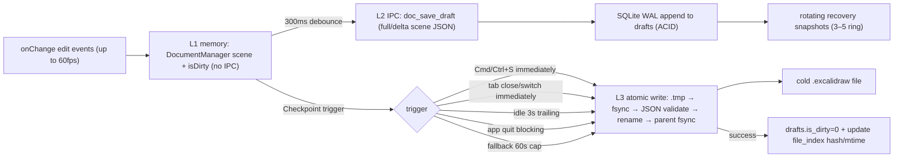
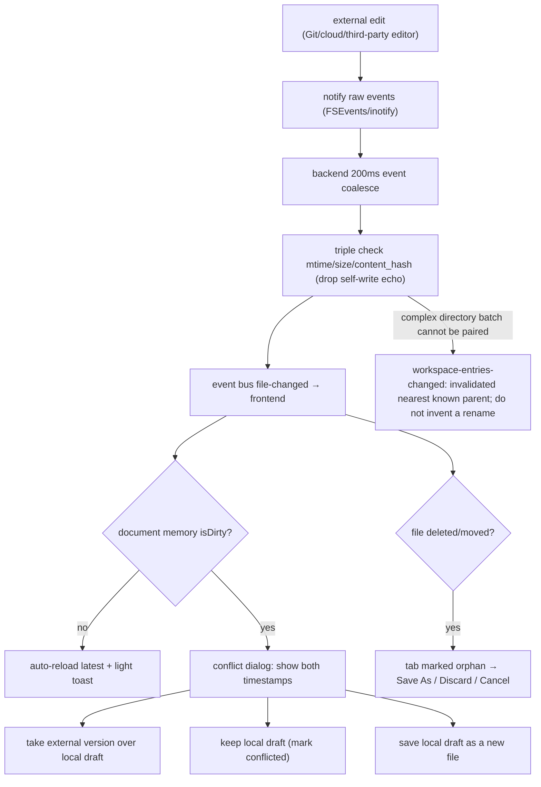
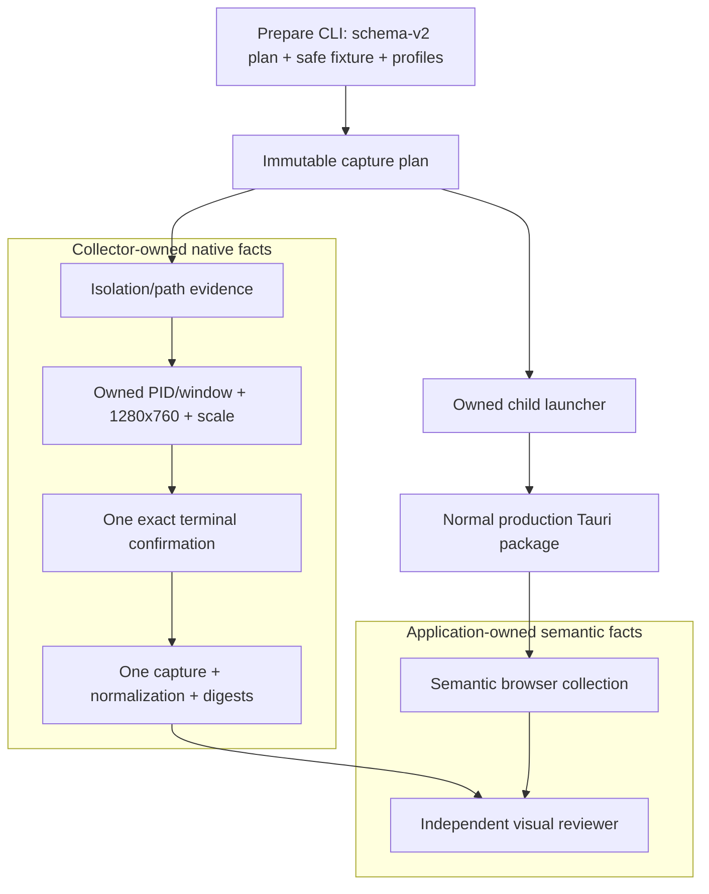

[English](architecture.md) | [简体中文](architecture.zh.md)

# Excalidraw Desktop architecture

**Last updated**: 2026-10-14

This document describes the **current** implementation architecture of Excalidraw Desktop: layered view, reliability data flows, workspace-entry mutations, module responsibilities, dependency direction and trust boundaries, native-window boundary, and storage. Decision records live in `docs/adr/`. The visual and interaction contract is the root `DESIGN.md` (English; Chinese: `DESIGN.zh.md`). The public IPC contract is `docs/contracts/ipc-contracts.md` (v5).

The current shell is a canvas-first overlay/pinned sidebar, IPC v5 Workspace Entry, version-history, and native-menu commands, a frontend-owned UI language, and unified in-app menus/dialogs. Crash-safe persistence (drafts, atomic writes, recovery snapshots, external-change conflicts) still applies. What follows is the current path, not the retired FileTree + `thumbnails/` production implementation.

Workspace persistence separates mounted authority from Recent history. Mounted records feed path policy, Workspace Entry commands, indexing, and watching; only the single Current Workspace feeds the Sidebar tree. Mounted means "open in a window": the Rust `WindowRegistry` (`src-tauri/src/window/registry.rs`) is the only authority on which window holds which Workspace, at most one window per Workspace; `workspace_list` returns the calling window's Workspace only, and Workspace and document events are sent to the owning window (`src-tauri/src/window/events.rs`). Sidebar pin, width, and expansion are stored per Workspace in SQLite; appearance and language stay in WebView storage and are broadcast to the other windows after a change. Unmounting retains the record; remount validates the stored root on activation, while removing an unmounted record from Recents changes application history only.

## 1. Overall structure

Tauri 2.x dual-process layout: `src/` is the React 19 + TypeScript strict frontend; `src-tauri/` is the Rust backend. The two sides communicate across an IPC contract boundary (`docs/contracts/ipc-contracts.md`). Full technology choices: ADR-001 (framework), ADR-002/003 (persistence), ADR-004/006/007/008 (reference performance measurement and budgets), ADR-005 (theme boundary; the “file manager on the left / canvas on the right” shell layout and thumbnail-contract sentences are superseded by ADR-009), ADR-009 (desktop UI interactions: title-bar option A, canvas-first sidebar, thumbnail retirement, v2 WorkspaceEntry plus v3 version-history commands, unified menus/dialogs).

## 2. Layered view



Dependencies flow one way, top down: shell / interaction / tree / DocumentManager → IpcClient → Contracts → Commands → `security/` → domain services → storage.

Constraints (fixed jointly by the code and ADR-009):

- The frontend does not decide path authorization, directory emptiness, protected entries, Trash eligibility, or whether a rename commit succeeded; those live in Rust `workspace_entries/` and `security/`.
- The Workspace Entry domain does not take a frontend session id; the rename response returns `pathMigrations`, which DocumentManager applies to its own sessions.
- Tab presentation is derived from DocumentManager; there is no second source of truth for path/title/dirty/orphan.
- The interaction layer has at most one menu and one dialog globally (`src/app/interaction/interactionStore.ts`).
- **No thumbnail runtime**: there is no `thumbnails/` module, thumbnail Worker, or production `thumb_lookup` / `thumb_store`. The asset protocol only serves real in-drawing image assets (`.excalidraw_assets`).
- The native title bar is outside Web content: ordinary decorated `Visible` window, OS-controlled title-bar color, normal stacking; the production path is not always-on-top.

The theme module only manages non-document appearance preferences and supplies resolved values to the shell/canvas. It does not enter IPC or the document model.

## 3. Data-flow 1: edit → draft → disk (three-tier coalescing)



The high-frequency edit path does not serialize the full scene, send IPC, or write disk on every event: L1 updates in-memory state (no IPC), L2 writes a SQLite WAL draft after a 300ms debounce, and L3 atomically lands the cold `.excalidraw` file when a checkpoint fires, so most edit events never write the cold file immediately. The atomic-write pipeline and fault-injection points are in ADR-002.

### 3.1 Version-history transaction and process-fault boundary

Version history is a separate durability plane. A protected replacement first
publishes immutable scene/assets objects and durable protection/intent metadata,
then uses the shared document lock and guarded atomic rename before repairing
the main draft/index state. The current file, history SQLite store, and object
store are therefore observed independently during restart reconciliation; an
`after_rename_before_parent_sync` result is `pendingReconciliation`, not an
assumption that the old file survived.

Each saved drawing has a persistent history `documentId` that is independent
of its current path, frontend tab UUID, and version IDs. The production store
lives below the Tauri app-data directory at `version-history/history.sqlite3`
with immutable scene and asset objects beside it. Application-owned file and
ancestor-directory renames migrate the same identity; Save As creates a new
identity with no inherited versions. The backend also records filesystem
identity (on macOS, device/inode plus supporting metadata), so a different
file later appearing at the old path cannot inherit the old history. A deleted
drawing leaves a deleting identity tombstone while semantic versions are
removed, preventing same-path reuse from attaching to the old document.

Ordinary history is driven only by a successfully completed cold checkpoint.
The first successful checkpoint establishes a durable per-document baseline;
the first changed checkpoint at least 30 minutes later publishes the exact
immutable scene and asset bytes from that save. Manual and protected versions
do not move this baseline, and no history-only timer catches up while the app
is idle. Automatic-history failure is reported through the independent
`history-issue` state/event and never rewrites a successful current-file save
as failed. Manual marks publish the click-time scene as an uncapped `manual`
record; equal bytes may reuse objects without collapsing semantic records.
Automatic and protected records continue to share the newest-20 pool.

Canvas clear and drawing import use the same `history_replace` coordinator as
restore. The host captures clear/import shortcuts and possible scene-file drops
before Excalidraw handles them. A dropped PNG/SVG is parsed before dispatch:
embedded scenes enter protected replacement; ordinary images resume the SDK's
single-insertion path. Library drops and text editing stay SDK-owned. The
frontend only adopts a backend-confirmed replacement for the current document;
an uncertain result keeps that document read-only until reconciliation.

The test-only `e2e-harness` exposes seven process barriers. The parent process
waits for the exact ready marker, verifies the marker's isolated target path,
sends `SIGKILL`, and starts a fresh probe with the same isolated root. A
timeout or a still-live PID is a failure. Standalone fixtures validate the
marker protocol only; operation evidence runs the real protected-replacement
service for object publication, protection, intent, rename/directory sync,
metadata/acknowledgement, and retention-eviction boundaries. Deterministic
typed object (`ENOSPC`/`EACCES`) and SQLite pre-commit faults remain test-only,
while missing/corrupt objects, concurrent requests, external writes, response
loss, and stale queued autosaves are checked through fresh-process or exact
frontend-driver readback. Each evidence owner stays separate.

| Barrier                                 | Product boundary                                 | Required restart question                                                          |
| --------------------------------------- | ------------------------------------------------ | ---------------------------------------------------------------------------------- |
| `object_publish`                        | immutable history object publication             | no partial target bytes or untracked object is accepted                            |
| `protection_commit`                     | durable protection record                        | failed protection leaves replacement unapplied                                     |
| `intent_commit`                         | replacement intent record                        | restart reconciles old/new/pending from durable facts                              |
| `after_rename_before_parent_sync`       | target rename before parent sync                 | published identity is not reported as old merely because sync is unknown           |
| `metadata_complete_before_frontend_ack` | backend complete before frontend acknowledgement | response loss is recovered by request-id status, without replay                    |
| `eviction_delete_gc`                    | retention commit before reachability GC          | pre-intent crash keeps the old file; GC removes only genuinely unreachable objects |
| `rename_delete_repair`                  | restart draft/index repair                       | lifecycle repair follows durable identity and bytes                                |

The fault harness is compiled and registered only with `--features e2e-harness`
and `APP_E2E=1`; production builds must omit the commands and harness strings.
All native runs use a fresh `excalidraw-desktop-e2e-*` root and record the
platform, filesystem, binary digest, seed, barrier marker, process signal, and
post-restart hashes.

Frontend draft scheduling carries the captured session generation and revision.
After replacement adoption advances either value, a queued callback captured
from the old session is rejected before `doc_save_draft` or checkpoint IPC.
The native journey additionally verifies that the cold target and clean draft
do not contain the stale attempted scene.

## 4. Data-flow 2: external change → conflict resolution

Entry rename or delete coordinates with this external-change flow. It does not weaken atomic writes, recovery snapshots, conflict blocking, or debounce/coalesce.



External changes are perceived within about 3 seconds. A (mtime, size, content_hash) triple confirms a real change and suppresses self-write echo. A conflicted document must not auto-checkpoint until the user chooses in the conflict dialog. The app's own entry mutations treat the command response as authoritative; watcher events that match `operationId` are echo.

## 5. Data-flow 3: workspace entry create / rename / delete

A filesystem rename, the OS Trash, or an atomic create is the commit point. Failure before commit must keep the old path. After commit, derived index/watcher work may retry, but it must not report an already-committed disk change as uncommitted.

```mermaid
flowchart LR
    Intent["user entry action"] --> UIState{"action"}
    UIState -->|"create / rename"| Naming["app naming dialog"]
    Naming -->|"cancel"| NoMutation["close and restore focus; zero mutation"]
    Naming -->|"submit"| Preflight["DocumentManager identifies affected Open Documents"]
    Preflight --> Checkpoint["checkpoint affected sessions and capture baseHash"]
    Checkpoint --> MutCmd["workspace_entry_create / workspace_entry_rename"]
    UIState -->|"delete"| Dirty{"open and dirty/conflicted/saving?"}
    Dirty -->|"yes"| FocusDoc["block and focus the Open Document"]
    Dirty -->|"no"| DeleteCheck["workspace_entry_delete_preflight"]
    DeleteCheck -->|"non-empty directory"| Blocker["app blocker dialog"]
    DeleteCheck -->|"confirmable"| Confirm["app delete confirmation"]
    Confirm -->|"confirm"| DeleteCmd["workspace_entry_delete; carries expectedOpenDocument"]
    MutCmd --> RustGate["Rust Workspace mutation gate"]
    DeleteCmd --> RustGate
    RustGate --> SecurityCheck["containment, symlink, protected, name/conflict/emptiness"]
    SecurityCheck -->|"fail"| StructuredError["structured error; dialog/tree/session unchanged"]
    SecurityCheck -->|"Rename commit"| FsRename["filesystem rename"]
    SecurityCheck -->|"Delete commit"| OsTrash["OS Trash"]
    SecurityCheck -->|"Create commit"| FsCreate["atomic Drawing or Directory create"]
    FsRename --> Result["response: operationId + pathMigrations"]
    OsTrash --> Cleanup["delete exact clean draft/index metadata"]
    Cleanup --> Result
    FsCreate --> Result
    Result --> Apply["DocumentManager applies session changes once"]
    Apply --> Refresh["invalidate tree; restore scroll anchor and focus"]
```



Authoritative layers: `src-tauri/src/workspace_entries/` and `src/documents/documentStore.ts`. New drawings default to the visible name `Untitled`; Rust appends `.excalidraw`. New directories default to `Untitled Folder` (`src/app/interaction/EntryNamingDialog.tsx`). Welcome New Drawing (`src/app/newDrawing.ts`) asks for a folder each time, claims it for the window (`window_claim_workspace`; a folder held by another window brings that window to the front and creates nothing), uses the same `workspace_entry_create` path there, and steps past `NAME_CONFLICT` to `Untitled N`; it never creates a pathless document session. Protected targets include the workspace root, dot directories, and `.excalidraw_assets`.

## 6. Sequence: serialized close and latest-intent activation

```mermaid
sequenceDiagram
    participant Input as Tab / wheel input
    participant DM as DocumentManager
    participant Scheduler as DraftScheduler
    participant IPC as Rust document commands
    participant UI as TabBar
    Input->>DM: requestClose(id) or requestActivation(id)
    alt the same close is already in flight
        DM-->>Input: join the existing result
    else start activation or close
        DM->>Scheduler: checkpoint current/target as needed
        Note over DM: a newer activation only replaces pendingLatestId
        Scheduler->>IPC: doc_checkpoint
        IPC-->>Scheduler: success or structured failure
        alt success
            DM->>IPC: on close, doc_close (checkpointed or discardOrphan)
            DM->>UI: update the single session/tab order
            DM->>DM: drain only the latest pending activation
        else failure or cancel
            DM->>UI: keep the tab and focus; show the error
            Note over DM: a batch close stops before unprocessed ids
        end
    end
```

Closing an orphaned document must not send a checkpoint that requires the missing path to exist. `doc_close` with `discardOrphan` only clears draft/recovery/session records for that path.

## 7. Module responsibilities

### Frontend (`src/`)

| Module                         | Responsibility                                                                                                                                                                                           |
| ------------------------------ | -------------------------------------------------------------------------------------------------------------------------------------------------------------------------------------------------------- |
| `app/AppShell.tsx`             | Canvas-first shell; overlay covers the canvas without changing the canvas box; pinned enters the layout; no empty right pane                                                                             |
| `app/sidebarController.ts`     | Sidebar `hidden` / `overlay` / `pinned`; overlay auto-closes 500ms after pointer leave; focus/menu/dialog/drag hold pauses auto-close                                                                    |
| `app/interaction/`             | One global menu and dialog, focus return; naming/delete/blocker dialogs; no `window.prompt` / `window.confirm`                                                                                           |
| `app/theme/`                   | Theme types, registry, preference resolution, semantic tokens, and pre-startup apply (DESIGN.md); decoupled from system title-bar color                                                                  |
| `editor/`                      | ExcalidrawAdapter + canvas, scene serialization, export, offline fonts, IME bridge; only the locked package's public API                                                                                 |
| `documents/`                   | DocumentManager: session identity, tab order, dirty/orphan/conflict, close/activation queues, path migration, recovery UI                                                                                |
| `workspaces/WorkspaceTree.tsx` | One continuous virtualized tree for the Current Workspace and its descendants; other workspace records are reached through Welcome/Recent; no thumbnail rows                                             |
| `i18n/`                        | UI language: `resolveLanguage` (the only rule mapping preference + system languages to `en` / `zh-CN` / `es` / `ja`), `LocaleController` (preference persistence), message catalogs, `readSystemLanguages` (handshake) |
| `app/nativeMenuSync.ts`        | Builds the localized native-menu label set and sends deduplicated `native_menu_sync` snapshots                                                                                                           |
| `app/clipboard.ts`             | Copy Path / Copy Relative Path: reads the path when the menu item is chosen and writes text through the clipboard plugin (write-only)                                                                    |
| `app/exitCheckpoint.ts`        | Per-window close checkpoint, peer-close request, and quit checkpoint handlers; a failed checkpoint leaves the window open                                                                                |
| `app/openFileHandler.ts`       | Opens routed drawings (`open-file-request`, `window-activate-document`) and the restored tabs of this window                                                                                             |
| `ipc/`                         | Typed v5 command bindings and event subscription (`IPC_CONTRACT_VERSION = 5`)                                                                                                                            |

### Backend (`src-tauri/`)

| Module               | Responsibility                                                                                                                   |
| -------------------- | -------------------------------------------------------------------------------------------------------------------------------- |
| `commands/`          | IPC command entry (thin layer: deserialize → validate → call domain services)                                                    |
| `workspace_entries/` | Workspace Entry domain: names, extension, protected items, real emptiness, conflicts, Trash, rename commit point, pathMigrations |
| `documents/`         | Atomic write, recovery, validation, asset dedup, session lock                                                                    |
| `history/`           | Document identity, immutable scene/assets, retention, guarded replacement, operation status, and restart reconciliation          |
| `database/`          | Connection pool, writer thread, migrations, repository traits; runtime no longer reads/writes `file_meta` as a thumbnail cache   |
| `indexing/`          | Async workspace scan and incremental index                                                                                       |
| `watcher/`           | notify wrapper + debounce + echo suppression; complex external directory events emit `invalidated`                               |
| `security/`          | Path canonicalize, workspace ACL allowlist, symlink-escape rejection                                                             |
| `window/`            | `WindowRegistry` ownership, window creation, file-open router, quit coordinator, Window Session, placement and geometry          |

Historical `thumbnails/` and frontend `FileTree` / `useThumbnails` are **not** the current production path.

## 8. IPC trust boundary

- Contract: command/event schemas + error taxonomy + input validation are defined only in `docs/contracts/ipc-contracts.md`. The TypeScript source is `src/ipc/contracts.ts`; Rust DTOs are `src-tauri/src/commands/dto.rs`. The frontend must not bypass them. Current `IPC_CONTRACT_VERSION = 4`.
- Version-history commands are `history_list`, `history_preview`, `history_mark`, `history_replace`, `history_operation_status`, and `history_delete`. They carry document authorization and request identity, never history-store paths; `history_replace` is idempotent and an uncertain post-rename result remains `pendingReconciliation`.
- `history_delete` removes one semantic version while holding the document history-operation lease. Repeating the same `requestId` is idempotent; a version referenced by an active replacement remains protected and returns a structured busy error. Object garbage collection is best effort after the metadata transaction and preserves objects still shared or pinned by another operation.
- Entry-mutation authorization uses `workspaceId + relativePath` (plus `baseName` for create/rename). `canonicalPath` in the response is for opening and session migration. It is **not** authorization evidence the frontend may submit.
- Every path is canonicalized in the backend by `security/` and checked against the workspace allowlist. Escape returns `PATH_ACCESS_DENIED`. Document JSON is untrusted input (structure validation + size cap).
- Least privilege: Tauri capabilities are `core:default` + `core:window:allow-destroy` + `core:window:allow-set-title` + `clipboard-manager:allow-write-text` + `dialog:allow-open` + `dialog:allow-save` for windows labelled `window-*` (`src-tauri/capabilities/default.json`). The destroy permission lets the native close handler destroy a window only after its app-exit checkpoint completes; set-title lets a window show its drawing and Workspace in its title; write-text lets Copy Path put a path on the clipboard, and nothing grants reading the clipboard. Path ACL lives in Rust; extra fs capabilities are not used to give the WebView arbitrary filesystem access. Strict CSP; the asset protocol is limited to `.excalidraw_assets` images.
- The production command set does not include `dir_list`, `file_create` / `file_rename` / `file_delete`, or `thumb_lookup` / `thumb_store`.

### 8.1 Language and native-menu data flow

The UI language is decided only in the frontend. Rust reports facts and renders the native menu; it does not choose or translate text.

1. **Startup.** Rust reads the system UI languages once (`src-tauri/src/locale.rs`) and returns them as `preferredLanguages` in `app_handshake`. The frontend reads that list before the first render (`i18n/systemLanguages.ts`).
2. **Resolution.** `resolveLanguage(preference, preferredLanguages)` returns `en`, `zh-CN`, `es`, or `ja`. The user preference (`system` / `en` / `zh-CN` / `es` / `ja`) is stored in WebView `localStorage` under `excalidraw-desktop.language`; it never crosses IPC. Any Spanish tag matches `es`, and any Japanese tag matches `ja`.
3. **Menu sync.** `AppShell` sends `native_menu_sync` with the full localized label set plus the menu state (language, appearance, document presence, forced read-only, and the five canvas preferences). The frontend skips a request identical to the last successful one, so ordinary canvas edits never reach the menu.
4. **Rust side.** The command validates labels and state at the trust boundary, then either rebuilds the menu (labels changed) or updates `checked` / `enabled` in place (state-only change). Invalid input is rejected and the last valid menu stays installed. Until the first sync, a built-in English menu is installed.
5. **Menu command.** Rust handles New Window and Quit itself. Every other item emits `native-menu-command` to the front window, or to the most recently focused window when none is in front. Menu state is kept per window and applied when a window gains focus. The frontend routes it (language, appearance, canvas preference toggles, help, save, export, version history) and writes the new state back through the next `native_menu_sync`.

Key ownership: the native menu registers accelerators only for New Window (`CmdOrCtrl+Shift+N`), Open Workspace (`CmdOrCtrl+Shift+O`), Save (`CmdOrCtrl+S`), Export Image (`CmdOrCtrl+Alt+E`), and Quit (`CmdOrCtrl+Q`). Keys the Excalidraw SDK handles are not registered natively, and `Alt+R` (View mode) is handled by the editor host. The full table is in `docs/contracts/ipc-contracts.md` §1.7.1.

## 9. Native-window boundary (option A)

Configuration and implementation: `WINDOW_CHROME` in `src-tauri/src/window/mod.rs` (every window is built from it) and `src-tauri/src/lib.rs` (no production title-bar tint / always-on-top). `tauri.conf.json` declares no window. ADR-009 records the choice.

| Item            | Current product behavior                                                                                                                           |
| --------------- | -------------------------------------------------------------------------------------------------------------------------------------------------- |
| Window model    | Ordinary decorated window; Overlay / Transparent / frameless are not configured                                                                    |
| Title           | `Excalidraw` until the frontend sets it: `<Workspace>`, or `<drawing> — <Workspace>` when a drawing is active                                      |
| Title-bar color | OS-controlled; not forced by content `light \| dark \| system`                                                                                     |
| Content theme   | Frontend resolves independently; `system` follows `prefers-color-scheme`                                                                           |
| Stacking        | Normal z-order; other apps can cover it; it can minimize and restore                                                                               |
| always-on-top   | Off in production. `e2e_harness` may pin the measurement window only when `EXCALIDRAW_PERF_CONTROL_DIR` exists; that must not leak into production |

### 9.1 Multi-window ownership and lifecycle

Decision record: ADR-010. Code: `src-tauri/src/window/`, `claim_for_window` in `src-tauri/src/commands/workspace.rs`, `src/app/exitCheckpoint.ts`, `src/app/openFileHandler.ts`. Wire shapes: `docs/contracts/ipc-contracts.md` §1.8, §1.9, and §2.

**Windows.** Rust creates every window at runtime with a label `window-<n>` that is never reused. The capability applies to `window-*`, and the frontend cannot create windows. `app_handshake` returns per-window startup data (Workspace, restored tabs, Recovery role); the frontend does not infer them from the URL. File > New Window (`CmdOrCtrl+Shift+N`) and `window_new` open a Welcome window.

**Ownership.** `WindowRegistry` is the only authority on which window holds which Workspace and which drawing. One lock covers every change, so concurrent claims are serialized. Claiming a Workspace returns one of four decisions; the caller's own current Workspace is ignored because the claim replaces it.

| Decision       | When                                                        | Effect                                                                                         |
| -------------- | ----------------------------------------------------------- | ---------------------------------------------------------------------------------------------- |
| `claimed`      | No other window holds the folder or a nested/containing one | The window takes the Workspace and releases its previous one; `mounted` and the watcher follow |
| `ownedBy`      | Another window holds the same Workspace                     | That window is brought to the front; the caller is unchanged                                   |
| `insideOpen`   | The folder lies inside another window's Workspace           | That window is brought to the front and reveals the folder in its sidebar                      |
| `containsOpen` | The folder contains another window's Workspace              | The caller is unchanged; the user may close that window and open the folder here (peer close)  |

A drawing is held by at most one window, and a drawing inside another window's Workspace counts as held by that window. `doc_open` returns `ownedElsewhere` instead of reading the file, and the backend brings the holder forward and sends it `window-activate-document`. Write commands from a window that does not hold the drawing fail with `DOCUMENT_NOT_OWNED`, so a drawing's draft and checkpoint have one owner.

**File-open routing.** Finder, a second launch, and launch arguments all reach `window/router.rs` after their paths are granted. A drawing goes to the window that already has it, else the window whose Workspace contains it, else the most recently focused window, else a new window. A window that has not read its startup data yet receives its paths through the handshake (`pendingOpenPaths`); other windows receive `open-file-request`.

**Event and menu routing.** Workspace events go to the Workspace's holder and document events to the drawing's holder; an event with no holder is dropped. Frontend listeners filter by their own window, because Tauri also delivers a window-addressed event to listeners that did not name a window. `native-menu-command` goes to the focused window, or to the most recently focused one. Menu state is stored per window and applied when a window gains focus. Appearance and language are app-wide and are relayed to the other windows by `app_preferences_broadcast`.

**Close and quit.** Closing a window runs `checkpointAll`, then destroys the window; if the checkpoint fails the window stays open. On destroy, Rust releases the window's Workspace and drawings, stops its watcher, and rewrites the Window Session. Closing the last window on macOS keeps the app running. Quit is an application-owned menu item. `QuitCoordinator` asks every window to checkpoint (`app-quit-requested`), waits for `app_quit_ready` from each, and exits only when all report success. A failure, or no answer within 10 seconds, cancels the quit, brings the failing window forward, and sends `app-quit-cancelled` to all windows. Terminations Rust cannot intercept, such as Dock Quit or logout, still store the Window Session in the `RunEvent::Exit` handler on a best-effort basis.

**Window Session and placement.** The Window Session is a SQLite snapshot of the windows to restore: each window's Workspace and its tab paths with the active tab. A write replaces the whole table in one transaction and is coalesced for 500 ms; Welcome windows with no tabs are not stored. At launch Rust recreates the stored windows and claims each Workspace before showing its window. An unavailable Workspace leaves its window on Welcome with an explanation, and missing files are skipped and counted. After an abnormal exit only a Recovery window opens, and the stored windows are recreated once it calls `startup_recovery_done`. Window placement (normal-state bounds in logical pixels, maximized, full screen) is stored per Workspace, written with the same 500 ms coalescing, and checked against the connected displays on restore: a window whose title bar would be unreachable moves to the primary display. Sidebar pin, width, and expanded folders are stored per Workspace as well.

**Copy path.** Sidebar rows and tab context menus offer Copy Path and Copy Relative Path. The Workspace root row offers Copy Path only. A tab offers Copy Path when the drawing has a path, and Copy Relative Path only when the drawing lies inside the window's Workspace. The path is read when the item is chosen, so a renamed, moved, or deleted item is never copied with a stale path; if it no longer exists the window shows a short notice. Relative paths use `/` and are relative to the Workspace root. The write goes through the clipboard plugin, which is granted write-text only; the app cannot read the clipboard.

## 10. Storage

| Tier     | Carrier                                                                      | Notes                                                                                                      |
| -------- | ---------------------------------------------------------------------------- | ---------------------------------------------------------------------------------------------------------- |
| Hot      | SQLite WAL (`drafts` / `workspaces` / `file_index`)                          | Drafts and index. The v1 `file_meta` table is a lazy compatibility leftover, not an active thumbnail cache |
| Cold     | Filesystem `*.excalidraw` (atomic replace); `.excalidraw.json` is recognized | Source of truth; new drawings default to `.excalidraw`                                                     |
| Recovery | `recovery/*.json` rotating snapshots + `session.lock`                        | Crash recovery                                                                                             |
| Trash    | OS Trash                                                                     | Commit point for empty Directory and clean Drawing deletes; no recursive / permanent-delete command        |
| History  | App-data `version-history/history.sqlite3` + immutable scene/asset objects   | Persistent document identity, version metadata, protected operation state, and reachability-controlled GC  |

Storage design detail is in ADR-002 (two-tier persistence) and ADR-003 (SQLite-first and the redb trigger). The hot tier keeps WAL drafts. Do not switch back to in-place cold-file overwrites, and do not remove recovery snapshots.

## 11. Native visual validation layers

This section describes the collector boundary and evidence ownership used by the native tooling. The detailed historical validation record belongs in [`docs/evidence/validation-summary.md`](evidence/validation-summary.md); collector architecture alone does not establish a current release gate.

Native visual capture is a collector-side validation path, not a production IPC path. The collector prepares safe fixtures and immutable schema-v2 plans, launches the ordinary production package with an isolated profile, and records only package/isolation/window/capture facts. Semantic browser evidence remains the owner of app state and interaction facts.



## 12. Native capture request-to-ready flow

```mermaid
sequenceDiagram
  participant P as Prepare CLI
  participant L as Owned launcher
  participant A as Production package
  participant D as Native collector
  participant W as Semantic browser collector
  P->>P: Validate package, manifest, fixture and isolation paths
  P->>P: Create distinct empty profiles and schema-v2 plan
  L->>A: Launch normal package with isolated HOME
  D->>D: Validate child PID, one owned window and two stable 1280x760 samples
  D-->>L: Print visual checklist and CAPTURE gate challenge
  L->>D: Accept exact confirmation once within timeout
  D->>D: Revalidate same PID/window/bounds/scale
  D->>D: Capture once and write capture-readiness/isolation artifacts
  D->>D: Normalize without crop or repair; hash immutable outputs
  W->>W: Independently prove semantic state, geometry, fonts and interaction
  D-->>W: Bind package/capture collection for later independent review
```

The collector owns only its child process and declared profile. Missing isolation, an ambiguous process/window, confirmation mismatch/timeout, path escape, changed package/plan, dimension mismatch or a fourth same-direction retry produces structured `BLOCKED`/`FAIL`; the collector never claims that the requested UI state is visible.

## 13. Related documents

- ADRs: ADR-001 framework choice, ADR-002 two-tier persistence, ADR-003 SQLite-first and redb trigger, ADR-004 declared reference-environment performance measurement, ADR-005 theme boundary (shell-layout / thumbnail sentences: see ADR-009), ADR-006/007/008 reference performance budgets and measurement series, ADR-009 desktop UI interactions, ADR-010 multi-window
- `DESIGN.md` / `DESIGN.zh.md` (visual and interaction contract)
- `docs/quickstart.md` / `docs/quickstart.zh.md` (getting started and verification), `docs/contracts/ipc-contracts.md` (IPC contract v5)
- `docs/evidence/` (native verification matrix, accessibility audit, and validation summary; VM or physical machine)
