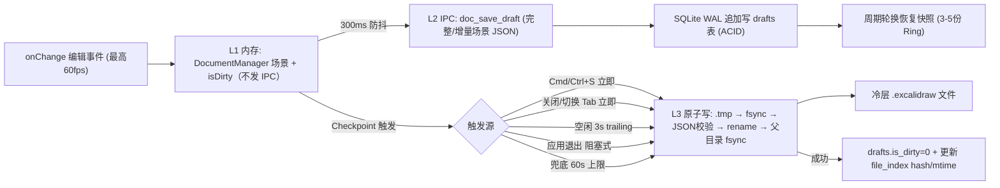
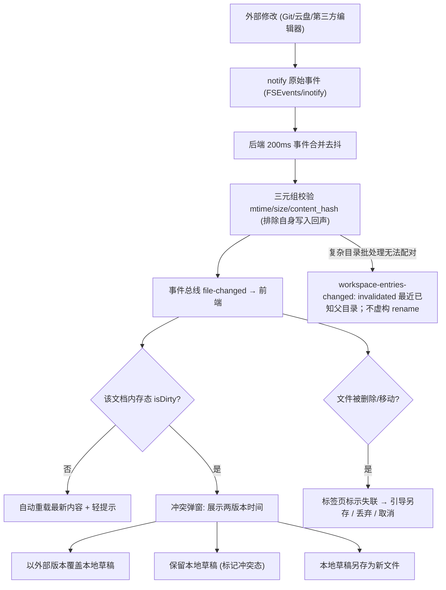
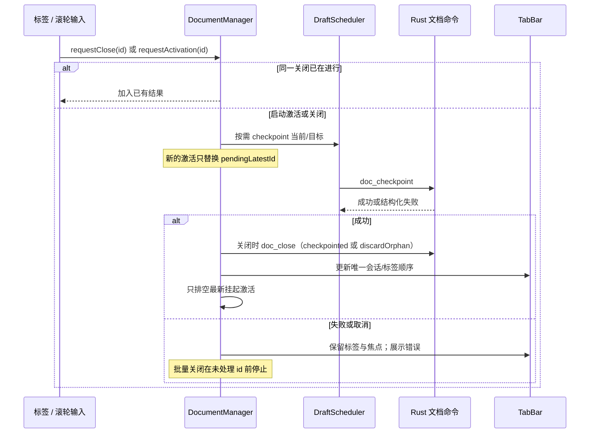
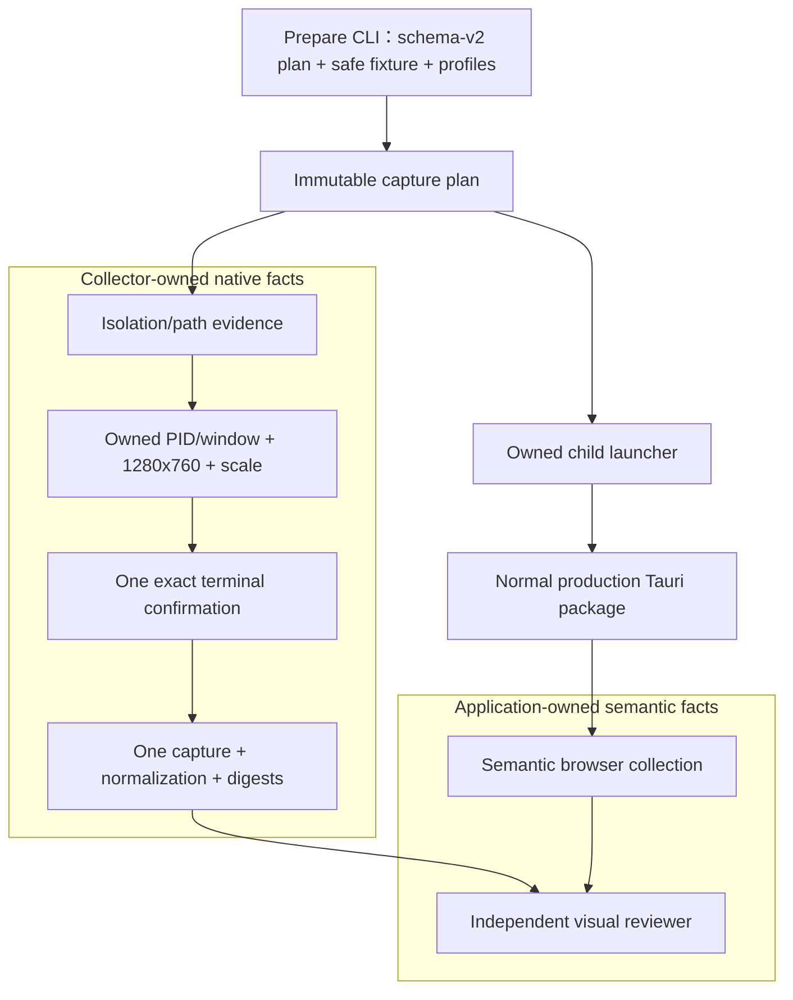
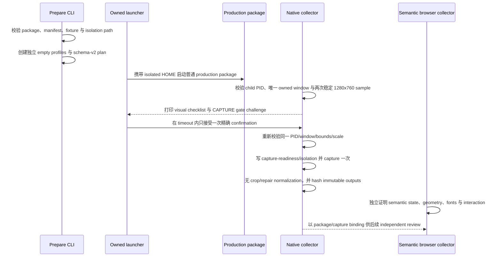

[English](architecture.md) | [简体中文](architecture.zh.md)

# Excalidraw Desktop 架构文档

**最后更新**：2026-10-14

本文档描述 Excalidraw Desktop 的**当前**实现架构：分层视图、可靠性数据流、工作区条目变更、模块职责、依赖方向与信任边界、原生窗口边界与存储层。决策记录见 `docs/adr/`；视觉与交互契约见根目录 `DESIGN.md`（英文正文；中文见 `DESIGN.zh.md`）。公开 IPC 契约见 `docs/contracts/ipc-contracts.md`（v5）。

当前壳层是画布优先的 overlay/pinned 侧边栏、IPC v5 Workspace Entry、版本历史与原生菜单命令、由前端决定的 UI 语言，以及统一的应用菜单/对话框。崩溃安全持久化（草稿、原子写、恢复快照、外部变更冲突）仍然有效。下文描述的是现行路径，不是已退休的 FileTree + `thumbnails/` 生产实现。

Workspace 持久化将 mounted authority 与 Recent history 分开。已挂载记录进入路径策略、Workspace Entry 命令、索引与监听；只有唯一的 Current Workspace 进入 Sidebar 树。“已挂载”的含义是“正在某个窗口中打开”：Rust `WindowRegistry`（`src-tauri/src/window/registry.rs`）是窗口持有哪个 Workspace 的唯一权威，每个 Workspace 至多由一个窗口持有；`workspace_list` 只返回调用窗口的 Workspace，Workspace 与文档事件只发给持有它的窗口（`src-tauri/src/window/events.rs`）。侧栏固定、宽度与展开状态按 Workspace 存于 SQLite；外观与语言仍存于 WebView 存储，改变后广播给其他窗口。取消挂载会保留记录；重新挂载只在激活时校验保存的 root，而从 Recents 移除未挂载记录只改变应用历史。

## 1. 总体结构

Tauri 2.x 双端布局：`src/` 为 React 19 + TypeScript strict 前端，`src-tauri/` 为 Rust 后端；两端经 IPC 契约边界通信（`docs/contracts/ipc-contracts.md`）。完整技术选型见 ADR-001（框架）、ADR-002/003（持久化）、ADR-004/006/007/008（参考性能测量与预算）、ADR-005（主题边界，其中「左侧文件管理 / 右侧画布」壳层布局与缩略图契约句已被 ADR-009 取代）、ADR-009（桌面 UI 交互：标题栏选择 A、画布优先侧边栏、缩略图退休、v2 WorkspaceEntry 与 v3 版本历史命令、统一菜单/对话框）。

## 2. 分层视图

```mermaid
flowchart TB
    subgraph frontend [前端 React 19 + TypeScript strict]
        AppShell["app/AppShell：画布优先 · overlay/pinned 侧边栏"]
        Interaction["interaction store：全局唯一菜单与对话框"]
        Tree["workspaces/WorkspaceTree：Current Workspace 虚拟化树"]
        Docs["documents/ DocumentManager：会话 · 关闭/激活队列 · 路径迁移"]
        Editor["editor/ 官方 Excalidraw 公共集成"]
        Theme["app/theme/ 主题注册 · 偏好解析"]
        Prefs["版本化本地视图偏好：pinned 与展开集"]
        IpcClient["ipc/ 强类型 v5 客户端 + 事件订阅"]
    end
    subgraph boundary [IPC 信任边界]
        Contracts["contracts v5：WorkspaceEntry + History + 原生菜单命令 · 结构化错误 · operationId"]
    end
    subgraph backend [Rust 后端 Tauri 2.x]
        Commands["commands/ IPC 入口（薄层）"]
        EntryDomain["workspace_entries/ 名称 · 保护项 · 空性 · 废纸篓 · rename"]
        Security["security/ 路径规范化 + 工作区包含性"]
        DomainDocs["documents/ 原子写 · 草稿 · 恢复 · 冲突"]
        HistoryDomain["history/ 不可变对象 · 受保护替换 · 重启协调"]
        Indexing["indexing/ 工作区异步索引"]
        Watcher["watcher/ notify 去抖 + 回声抑制"]
    end
    subgraph storage [存储层]
        Hot["热层 SQLite WAL：drafts / workspaces / file_index；file_meta 惰性残留"]
        Cold["冷层 文件系统：*.excalidraw（原子替换）"]
        Recovery["恢复快照：recovery/*.json 轮换"]
        History["history SQLite + 不可变场景/资源对象"]
        Trash["操作系统废纸篓"]
    end
    AppShell --> Interaction
    AppShell --> Tree
    AppShell --> Docs
    AppShell --> Editor
    Interaction --> Prefs
    Tree --> Prefs
    Theme --> Editor
    Docs --> IpcClient
    Tree --> IpcClient
    IpcClient --> Contracts --> Commands
    Commands --> Security
    Commands --> EntryDomain
    Commands --> DomainDocs
    Commands --> HistoryDomain
    Commands --> Indexing
    Watcher --> Commands
    EntryDomain --> Indexing
    EntryDomain --> Cold
    EntryDomain --> Trash
    DomainDocs --> Hot
    DomainDocs --> Cold
    DomainDocs --> Recovery
    HistoryDomain --> History
    Indexing --> Hot
```

依赖方向自上而下单向：壳层 / 交互 / 树 / DocumentManager → IpcClient → Contracts → Commands → `security/` → 领域服务 → 存储。

约束（由代码与 ADR-009 共同固定）：

- 前端不裁决路径授权、目录空性、受保护条目、废纸篓资格或 rename 提交是否成功；这些在 Rust `workspace_entries/` 与 `security/`。
- Workspace Entry 领域不接收前端 session id；rename 响应返回 `pathMigrations`，由 DocumentManager 应用到自己的会话。
- 标签呈现派生自 DocumentManager；不另建一套 path/title/dirty/orphan 权威。
- 交互层全局至多一个菜单、一个对话框（`src/app/interaction/interactionStore.ts`）。
- **无缩略图运行时**：不存在 `thumbnails/` 模块、缩略图 Worker、或生产 `thumb_lookup` / `thumb_store`。asset protocol 仅服务于图纸内真实图片资产（`.excalidraw_assets`）。
- 原生标题栏在 Web 内容之外：普通装饰 `Visible` 窗口、系统控制标题栏颜色、正常层级；生产路径不 always-on-top。

主题模块仅管理非文档外观偏好并向壳层/画布提供解析结果，不进入 IPC 或文档模型。

## 3. 数据流图 1：编辑 → 草稿 → 落盘（三级削峰）

高频编辑路径不逐事件执行完整场景序列化、IPC 传输或磁盘写入：L1 内存态更新（不发 IPC）、L2 经 300ms 防抖写入 SQLite WAL 草稿、L3 checkpoint 触发时原子落盘到冷层 `.excalidraw` 文件，使绝大多数编辑事件不必立刻写冷文件。原子写流水线与故障验证点见 ADR-002。

### 3.1 版本历史事务与进程故障边界

版本历史是独立的持久化平面。受保护替换先发布不可变场景/资源对象及持久的保护/意图元数据，再复用共享文档锁和受保护的原子 rename，最后修复主草稿/索引状态。因此重启协调会独立观察当前文件、历史 SQLite 和对象存储；`after_rename_before_parent_sync` 的结果必须是 `pendingReconciliation`，不能因为目录同步未知就假定旧文件仍然存在。

每个已保存图纸都有持久的历史 `documentId`，它独立于当前路径、前端 tab UUID 和版本 ID。生产存储位于 Tauri app-data 目录下的 `version-history/history.sqlite3`，旁边保存不可变场景与素材对象。应用内改名或祖先目录改名会迁移同一个身份；Save As 会创建没有历史继承的新身份。后端还记录文件系统身份（macOS 上使用 device/inode 及辅助 metadata），因此后来出现在旧路径的另一个文件不能继承旧历史。删除图纸后会保留 `deleting` 身份墓碑并移除语义版本，避免同路径新文件重新绑定旧文档。

普通历史只由成功完成的冷 checkpoint 驱动。首次成功 checkpoint 建立持久的逐文档基线；至少 30 分钟后第一次包含变化的 checkpoint，使用该次保存的精确不可变场景和图片字节发布版本。手动版本和保护版本不推进这条基线，应用空闲时也没有历史专用 timer 追补。普通历史失败通过独立的 `history-issue` 状态／事件反馈，不能把已经成功的当前文件保存改写成失败。手动标记把点击时场景发布为不受上限影响的 `manual` 记录；相同字节可以复用对象，但不能合并语义记录。`automatic` 与 `protected` 继续共享最新 20 条池。

画布清空与绘图导入复用恢复使用的同一个 `history_replace` 协调器。宿主在 Excalidraw 处理前捕获清空／导入快捷键及可能携带场景的文件拖放。PNG/SVG 拖放先解析：内嵌场景进入受保护替换；普通图片只转交 SDK 插入一次。素材库拖放和文本编辑仍由 SDK 处理。前端仅为当前文档采用后端确认完成的替换；结果不确定时保持该文档只读，等待协调。

仅测试用的 `e2e-harness` 提供七个进程屏障。父进程等待精确 ready marker，验证 marker 中的目标路径仍在隔离根内，发送 `SIGKILL`，然后以同一隔离根启动全新的 probe。超时或 PID 仍存活均为失败。独立 fixture 只验证 marker 协议；事务证据则通过真实受保护替换服务覆盖对象发布、保护、意图、rename／目录同步、metadata／ack 以及 retention 淘汰边界。对象层使用 typed `ENOSPC`／`EACCES`，SQLite 在 commit 前使用 deterministic typed fault；缺失／损坏对象、并发、外部写入、响应丢失与旧排队 autosave 分别由 fresh-process 或精确 frontend driver readback 负责，不能相互替代。

| 屏障                                    | 产品边界                        | 重启必须回答的问题                               |
| --------------------------------------- | ------------------------------- | ------------------------------------------------ |
| `object_publish`                        | 历史不可变对象发布              | 不接受部分目标字节或未登记对象                   |
| `protection_commit`                     | 持久保护记录                    | 保护失败时替换未应用                             |
| `intent_commit`                         | 替换意图 SQLite 提交            | 按持久事实协调旧/新/待处理                       |
| `after_rename_before_parent_sync`       | 目标 rename 后、父目录同步前    | 同步未知时不把已发布身份报告为旧状态             |
| `metadata_complete_before_frontend_ack` | 后端完成、前端确认前            | 响应丢失按 request-id 查询，不重放替换           |
| `eviction_delete_gc`                    | retention 提交后、可达性 GC 前  | intent 前强退保留旧文件；GC 只删除真正不可达对象 |
| `rename_delete_repair`                  | 重启时 rename/delete 元数据修复 | lifecycle 修复遵守持久身份与实际字节             |

故障 harness 仅在 `--features e2e-harness` 且 `APP_E2E=1` 时编译和注册；生产构建必须没有这些命令及 harness 字符串。所有 native 运行使用新的 `excalidraw-desktop-e2e-*` 根，并记录平台、文件系统、二进制 digest、seed、屏障 marker、进程信号和重启后 hash。

前端草稿调度 payload 携带捕获时的 session generation 与 revision。替换采用推进任一值后，旧 session 捕获的排队 callback 会在 `doc_save_draft` 或 checkpoint IPC 前被拒绝；native journey 还会核对冷文件与 clean draft 都没有采用 stale attempted scene。

## 4. 数据流图 2：外部变更 → 冲突消解

条目重命名或删除会协调这条外部变更流，但不削弱原子写、恢复快照、冲突阻塞或去抖/合并。

外部变更大约在 3 秒内感知，以 (mtime, size, content_hash) 三元组校验真实变更并抑制自身写入回声；冲突态禁止自动 checkpoint，直至用户在冲突对话框中作出选择。应用自身条目变更以命令响应为权威，匹配 `operationId` 的 watcher 事件视为回声。

## 5. 数据流图 3：工作区条目创建 / 重命名 / 删除

文件系统 rename、操作系统废纸篓或原子创建才是提交点。提交前失败必须保持旧路径；提交后派生索引/watcher 可以重试，但不能把已提交的磁盘变更报告为未提交。

```mermaid
flowchart LR
    Intent["用户条目操作"] --> UIState{"动作"}
    UIState -->|"创建 / 重命名"| Naming["应用命名对话框"]
    Naming -->|"取消"| NoMutation["关闭并恢复焦点；零变更"]
    Naming -->|"提交"| Preflight["DocumentManager 识别受影响 Open Document"]
    Preflight --> Checkpoint["checkpoint 受影响会话并捕获 baseHash"]
    Checkpoint --> MutCmd["workspace_entry_create / workspace_entry_rename"]
    UIState -->|"删除"| Dirty{"打开且 dirty/conflicted/saving?"}
    Dirty -->|"是"| FocusDoc["阻断并聚焦对应 Open Document"]
    Dirty -->|"否"| DeleteCheck["workspace_entry_delete_preflight"]
    DeleteCheck -->|"非空目录"| Blocker["应用阻断对话框"]
    DeleteCheck -->|"可确认"| Confirm["应用删除确认"]
    Confirm -->|"确认"| DeleteCmd["workspace_entry_delete；携带 expectedOpenDocument"]
    MutCmd --> RustGate["Rust Workspace mutation gate"]
    DeleteCmd --> RustGate
    RustGate --> SecurityCheck["包含性、符号链接、保护项、名称/冲突/空性"]
    SecurityCheck -->|"失败"| StructuredError["结构化错误；对话框/树/会话保持"]
    SecurityCheck -->|"Rename 提交"| FsRename["文件系统 rename"]
    SecurityCheck -->|"Delete 提交"| OsTrash["操作系统废纸篓"]
    SecurityCheck -->|"Create 提交"| FsCreate["原子 Drawing 或 Directory 创建"]
    FsRename --> Result["响应：operationId + pathMigrations"]
    OsTrash --> Cleanup["删除精确的干净 draft/index 元数据"]
    Cleanup --> Result
    FsCreate --> Result
    Result --> Apply["DocumentManager 一次性应用会话变更"]
    Apply --> Refresh["树失效并恢复滚动锚点与焦点"]
```

权威层划分见 `src-tauri/src/workspace_entries/` 与 `src/documents/documentStore.ts`。新建图纸默认可见名 `Untitled`，Rust 追加 `.excalidraw`；新建目录默认 `Untitled Folder`（`src/app/interaction/EntryNamingDialog.tsx`）。Welcome 的 New Drawing（`src/app/newDrawing.ts`）每次询问文件夹并为本窗口认领（`window_claim_workspace`；该文件夹已被其他窗口持有时前置那个窗口，不创建文件），然后在其中走同一条 `workspace_entry_create` 路径，遇到 `NAME_CONFLICT` 时递增为 `Untitled N`；它不再创建无路径的文档会话。受保护目标包括工作区根、点号目录与 `.excalidraw_assets`。

## 6. 序列：串行关闭与最新意图激活

失联文档关闭不得对已缺失路径再发需要该路径存在的 checkpoint；`doc_close` 的 `discardOrphan` 只清理该路径的 draft/recovery/session 记录。

## 7. 模块职责

### 前端（src/）

| 模块                           | 职责                                                                                                                                                     |
| ------------------------------ | -------------------------------------------------------------------------------------------------------------------------------------------------------- |
| `app/AppShell.tsx`             | 画布优先壳层；overlay 覆盖画布且不改变画布盒；pinned 进入布局；无空右侧栏                                                                                |
| `app/sidebarController.ts`     | 侧边栏 `hidden` / `overlay` / `pinned`；overlay 指针离开 500ms 延迟关闭；focus/menu/dialog/drag hold 暂停自动关闭                                        |
| `app/interaction/`             | 全局唯一菜单与对话框、焦点返回；命名/删除/阻断对话框；不使用 `window.prompt` / `window.confirm`                                                          |
| `app/theme/`                   | 主题类型、registry、偏好解析、语义 token 与启动前应用（DESIGN.md）；与系统标题栏颜色解耦                                                                 |
| `editor/`                      | ExcalidrawAdapter + 画布组件、场景序列化、导出、离线字体、IME 桥接；只走锁定包的公开 API                                                                 |
| `documents/`                   | DocumentManager：会话身份、标签顺序、dirty/orphan/conflict、关闭/激活队列、路径迁移、恢复 UI                                                             |
| `workspaces/WorkspaceTree.tsx` | Current Workspace 及其后代的一棵连续虚拟化树；其他 workspace record 通过 Welcome/Recent 进入；无缩略图行                                                 |
| `i18n/`                        | UI 语言：`resolveLanguage`（偏好 + 系统语言到 `en` / `zh-CN` 的唯一规则）、`LocaleController`（偏好持久化）、文案目录、`readSystemLanguages`（握手读取） |
| `app/nativeMenuSync.ts`        | 生成本地化原生菜单标签集，并发送去重后的 `native_menu_sync` 快照                                                                                         |
| `app/clipboard.ts`             | 复制路径 / 复制相对路径：菜单项被选中时才读取路径，经剪贴板插件（只写）写入文本                                                                          |
| `app/exitCheckpoint.ts`        | 每个窗口的关闭 checkpoint、对等关闭请求与退出 checkpoint 处理；checkpoint 失败则窗口保持打开                                                             |
| `app/openFileHandler.ts`       | 打开被路由到本窗口的绘图（`open-file-request`、`window-activate-document`）及本窗口要恢复的标签                                                          |
| `ipc/`                         | 强类型 v5 命令绑定与事件订阅（`IPC_CONTRACT_VERSION = 5`）                                                                                               |

### 后端（src-tauri/）

| 模块                 | 职责                                                                                             |
| -------------------- | ------------------------------------------------------------------------------------------------ |
| `commands/`          | IPC 命令入口（薄层：反序列化 → 校验 → 调领域服务）                                               |
| `workspace_entries/` | Workspace Entry 领域：名称、扩展名、保护项、真实空性、冲突、Trash、rename 提交点、pathMigrations |
| `documents/`         | 原子写、恢复、校验、资产去重、会话锁                                                             |
| `history/`           | 文档身份、不可变场景/资源、保留、受保护替换、操作状态与重启协调                                  |
| `database/`          | 连接池、写线程、迁移、仓储 trait；运行时不再把 `file_meta` 当缩略图缓存读写                      |
| `indexing/`          | 工作区异步扫描与增量索引                                                                         |
| `watcher/`           | notify 封装 + 去抖 + 回声抑制；复杂外部目录事件发 `invalidated`                                  |
| `security/`          | 路径规范化、工作区 ACL 白名单、符号链接逃逸拒绝                                                  |
| `window/`            | `WindowRegistry` 归属、窗口创建、打开文件路由、退出协调、Window Session、窗口位置与几何          |

历史 `thumbnails/` 与前端 `FileTree` / `useThumbnails` **不是**当前生产路径。

## 8. IPC 信任边界

- 契约：命令/事件 Schema + 错误分类 + 输入校验，唯一定义于 `docs/contracts/ipc-contracts.md`；TypeScript 源为 `src/ipc/contracts.ts`，Rust DTO 为 `src-tauri/src/commands/dto.rs`。前端不得绕过。当前 `IPC_CONTRACT_VERSION = 4`。
- 版本历史命令为 `history_list`、`history_preview`、`history_mark`、`history_replace`、`history_operation_status` 和 `history_delete`。请求携带文档授权与 request identity，不携带 history-store 路径；`history_replace` 幂等，rename 后不确定结果保持 `pendingReconciliation`。
- `history_delete` 在持有文档 history-operation lease 时删除一条语义版本。重复使用同一 `requestId` 是幂等的；仍被活动替换引用的版本会受到保护并返回结构化 busy 错误。metadata 事务之后的对象 GC 是 best effort，仍被其他文档共享或被操作 pin 的对象会保留。
- 条目变更授权使用 `workspaceId + relativePath`（及创建/重命名的 `baseName`）。响应中的 `canonicalPath` 供打开与会话迁移使用，**不是**前端可提交的授权证据。
- 所有路径在后端经 `security/` canonicalize + 工作区白名单校验；越界返回 `PATH_ACCESS_DENIED`。文档 JSON 视为不可信输入（结构校验 + 尺寸上限）。
- 最小权限：Tauri Capabilities 为 `core:default` + `core:window:allow-destroy` + `core:window:allow-set-title` + `clipboard-manager:allow-write-text` + `dialog:allow-open` + `dialog:allow-save`，适用于 label 为 `window-*` 的窗口（`src-tauri/capabilities/default.json`）。销毁权限仅用于让原生关闭处理器在 app-exit checkpoint 完成后销毁窗口；设置标题权限让窗口在标题中显示图纸与 Workspace；写入文本权限让“复制路径”把路径放到剪贴板，不授予读取剪贴板。路径 ACL 在 Rust，不靠额外 fs capability 放开 WebView 任意文件系统。严格 CSP；asset protocol 仅限 `.excalidraw_assets` 图片。
- 生产命令集不含 `dir_list`、`file_create` / `file_rename` / `file_delete`、`thumb_lookup` / `thumb_store`。

### 8.1 语言与原生菜单数据流

UI 语言只在前端决定。Rust 只报告事实并渲染原生菜单，不选择也不翻译文案。

1. **启动。** Rust 启动时读取一次系统 UI 语言（`src-tauri/src/locale.rs`），经 `app_handshake` 的 `preferredLanguages` 返回；前端在首次渲染前读取该列表（`i18n/systemLanguages.ts`）。
2. **解析。** `resolveLanguage(preference, preferredLanguages)` 返回 `en` 或 `zh-CN`。用户偏好（`system` / `en` / `zh-CN`）保存在 WebView `localStorage` 键 `excalidraw-desktop.language`，不经过 IPC。
3. **菜单同步。** `AppShell` 发送 `native_menu_sync`，携带完整本地化标签集与菜单状态（语言、外观、是否有文档、强制只读及五项画布偏好）。与上次成功请求完全相同的请求会被前端跳过，因此普通画布编辑不会触达菜单。
4. **Rust 侧。** 命令在信任边界校验标签与状态，标签变化则重建菜单，仅状态变化则原地更新 `checked` / `enabled`。非法输入被拒绝，菜单保持上一次有效状态。首次同步前安装的是内置英文菜单。
5. **菜单命令。** New Window 与 Quit 由 Rust 自己处理；其余菜单项向前台窗口发出 `native-menu-command`，没有前台窗口时发给最近聚焦的窗口。菜单状态按窗口保存，窗口获得焦点时应用。前端路由该命令（语言、外观、画布偏好切换、帮助、保存、导出、版本历史），并在下一次 `native_menu_sync` 中回写新状态。

按键归属：原生菜单只为 New Window（`CmdOrCtrl+Shift+N`）、Open Workspace（`CmdOrCtrl+Shift+O`）、Save（`CmdOrCtrl+S`）、Export Image（`CmdOrCtrl+Alt+E`）与 Quit（`CmdOrCtrl+Q`）注册 accelerator；Excalidraw SDK 处理的按键不在原生侧注册，`Alt+R`（View mode）由编辑器宿主处理。完整表格见 `docs/contracts/ipc-contracts.md` §1.7.1。

## 9. 原生窗口边界（选择 A）

配置与实现见 `src-tauri/src/window/mod.rs` 的 `WINDOW_CHROME`（每个窗口都由它构建）与 `src-tauri/src/lib.rs`（无生产标题栏着色 / 置顶）。`tauri.conf.json` 不声明任何窗口。ADR-009 记录该选择。

| 项            | 当前产品行为                                                                                      |
| ------------- | ------------------------------------------------------------------------------------------------- |
| 窗口模型      | 普通装饰窗口；未配置 Overlay / Transparent / frameless                                            |
| 标题          | 前端设置前为 `Excalidraw`；之后是 `<Workspace>`，有活动绘图时为 `<绘图> — <Workspace>`            |
| 标题栏颜色    | 由操作系统控制，不随内容 `light \| dark \| system` 强制                                           |
| 内容主题      | 前端独立解析；`system` 跟随 `prefers-color-scheme`                                                |
| 层级          | 正常堆叠；可被其他应用覆盖、最小化、恢复                                                          |
| always-on-top | 生产关闭。`e2e_harness` 仅在 `EXCALIDRAW_PERF_CONTROL_DIR` 存在时可为测量窗口置顶，不得泄漏到生产 |

### 9.1 多窗口归属与生命周期

决策记录见 ADR-010。代码：`src-tauri/src/window/`、`src-tauri/src/commands/workspace.rs` 中的 `claim_for_window`、`src/app/exitCheckpoint.ts`、`src/app/openFileHandler.ts`。线上结构见 `docs/contracts/ipc-contracts.md` §1.8、§1.9 与 §2。

**窗口。** 所有窗口都由 Rust 在运行时创建，label 为 `window-<n>`，不复用。capability 作用于 `window-*`，前端不能创建窗口。`app_handshake` 按窗口返回启动数据（Workspace、要恢复的标签、Recovery 角色），前端不从 URL 推导。File > New Window（`CmdOrCtrl+Shift+N`）与 `window_new` 打开一个 Welcome 窗口。

**归属。** `WindowRegistry` 是哪个窗口持有哪个 Workspace、哪个绘图的唯一权威。所有变更在一把锁内完成，并发认领因此被串行化。认领 Workspace 返回四种判定之一；调用窗口自己当前的 Workspace 不参与判定，因为认领会替换它。

| 判定           | 条件                                           | 效果                                                                 |
| -------------- | ---------------------------------------------- | -------------------------------------------------------------------- |
| `claimed`      | 没有别的窗口持有该文件夹，也没有嵌套或包含关系 | 窗口取得 Workspace 并释放原来的；`mounted` 与 watcher 随之变化       |
| `ownedBy`      | 别的窗口持有同一个 Workspace                   | 该窗口被置前；调用窗口不变                                           |
| `insideOpen`   | 文件夹位于别的窗口的 Workspace 内              | 该窗口被置前，并在其侧栏中定位到该文件夹                             |
| `containsOpen` | 文件夹包含别的窗口的 Workspace                 | 调用窗口不变；用户可以选择关闭那个窗口并在此打开该文件夹（对等关闭） |

一个绘图至多由一个窗口持有，位于别的窗口 Workspace 内的绘图视为由该窗口持有。`doc_open` 返回 `ownedElsewhere` 而不读取文件，后端把持有者置前并向它发送 `window-activate-document`。不持有该绘图的窗口发来的写命令以 `DOCUMENT_NOT_OWNED` 失败，因此一个绘图的草稿与 checkpoint 只有一个 owner。

**打开文件路由。** Finder、二次启动与启动参数的路径在授权后都进入 `window/router.rs`。绘图依次发给：已经打开它的窗口、Workspace 包含它的窗口、最近聚焦的窗口、新窗口。尚未读取启动数据的窗口经握手的 `pendingOpenPaths` 收到路径，其他窗口收到 `open-file-request`。

**事件与菜单路由。** Workspace 事件发给 Workspace 的持有窗口，文档事件发给绘图的持有窗口；没有持有者的事件被丢弃。前端监听按自己的窗口过滤，因为 Tauri 也会把发给某个窗口的事件投递给没有指定窗口的监听。`native-menu-command` 发给前台窗口或最近聚焦的窗口。菜单状态按窗口保存，窗口获得焦点时应用。外观与语言是应用级的，由 `app_preferences_broadcast` 转发给其他窗口。

**关闭与退出。** 关闭窗口先执行 `checkpointAll` 再销毁窗口；checkpoint 失败则窗口保持打开。窗口销毁后，Rust 释放它的 Workspace 与绘图、停止其 watcher 并重写 Window Session。在 macOS 上关闭最后一个窗口不会退出应用。Quit 是应用自有的菜单项：`QuitCoordinator` 请每个窗口做 checkpoint（`app-quit-requested`），等待每个窗口的 `app_quit_ready`，只有全部成功才退出。有窗口失败，或 10 秒内没有应答，就取消退出、把失败的窗口置前并向所有窗口发送 `app-quit-cancelled`。Rust 无法拦截的终止（如 Dock 菜单退出、注销）仍会在 `RunEvent::Exit` 中尽力保存 Window Session。

**Window Session 与窗口位置。** Window Session 是 SQLite 中待恢复窗口的快照：每个窗口的 Workspace、标签路径与活动标签。一次写入在一个事务内替换整张表，并合并 500 ms；没有标签的 Welcome 窗口不保存。启动时 Rust 重建保存的窗口，并在显示窗口之前认领它的 Workspace。不可用的 Workspace 让窗口停留在 Welcome 并给出说明，缺失的文件被跳过并计数。异常退出后只打开 Recovery 窗口，待它调用 `startup_recovery_done` 后再重建保存的窗口。窗口位置（普通状态的逻辑像素边界、最大化、全屏）按 Workspace 保存，同样合并 500 ms 写入，恢复时对照当前连接的显示器检查：标题栏够不到的窗口移到主显示器。侧栏固定、宽度与展开目录同样按 Workspace 保存。

**复制路径。** 侧栏行与标签页右键菜单提供“复制路径”和“复制相对路径”。Workspace 根行只提供“复制路径”。标签页在绘图有路径时提供“复制路径”，只有绘图位于本窗口 Workspace 内时才提供“复制相对路径”。路径在菜单项被选中时读取，因此被重命名、移动或删除的条目不会带着过时路径被复制；条目已不存在时窗口显示简短提示。相对路径使用 `/`，相对于 Workspace 根。写入经剪贴板插件，只授予 write-text；应用不能读取剪贴板。

## 10. 存储层

| 层     | 载体                                                             | 说明                                                                  |
| ------ | ---------------------------------------------------------------- | --------------------------------------------------------------------- |
| 热层   | SQLite WAL（drafts / workspaces / file_index）                   | 草稿与索引。v1 `file_meta` 表作为惰性兼容残留保留，不是活动缩略图缓存 |
| 冷层   | 文件系统 `*.excalidraw`（原子替换）；支持识别 `.excalidraw.json` | 最终事实来源；新建图纸默认写入 `.excalidraw`                          |
| 恢复   | `recovery/*.json` 轮换快照 + `session.lock`                      | 崩溃恢复                                                              |
| 废纸篓 | 操作系统 Trash                                                   | 空 Directory 与干净 Drawing 的删除提交点；无递归/永久删除命令         |
| 历史   | app-data `version-history/history.sqlite3` + 不可变场景/素材对象 | 持久文档身份、版本 metadata、受保护操作状态与可达性控制的 GC          |

存储层设计细节见 ADR-002（双层持久化）与 ADR-003（SQLite-first 与 redb 触发条件）。热层保持 WAL 草稿，不改回就地覆盖冷文件，也不拆除恢复快照。

## 11. 原生视觉验收分层

本节描述原生工具的 collector 边界与证据归属。具体的历史验证记录见 [`docs/evidence/validation-summary.md`](evidence/validation-summary.md)；不能仅凭 collector 架构推断当前发布门槛。

Native visual capture 是 collector 侧验证路径，不是 production IPC 路径。Collector 负责安全 fixture、schema v2 immutable plan、隔离 profile、owned PID/window、一次性 terminal confirmation、normalization 与 digest；应用状态和交互事实仍由 semantic browser evidence 负责。

## 12. 原生 capture request-to-ready 数据流

Collector 只拥有自己启动的 child process 与声明的 profile。缺少 isolation、process/window 歧义、confirmation mismatch/timeout、path escape、package/plan 改变、dimension mismatch 或同一方向第四次 retry 时，输出结构化 `BLOCKED`/`FAIL`；collector 不声称目标 UI 状态可见。

## 13. 相关文档

- ADR：ADR-001 框架选型、ADR-002 双层持久化、ADR-003 SQLite-first 与 redb 触发条件、ADR-004 声明参考环境性能测量、ADR-005 主题边界（壳层布局/缩略图句见 ADR-009）、ADR-006/007/008 参考性能预算与测量序列、ADR-009 桌面 UI 交互、ADR-010 多窗口
- `DESIGN.md` / `DESIGN.zh.md`（视觉与交互契约）
- `docs/quickstart.md` / `docs/quickstart.zh.md`（上手与验证）、`docs/contracts/ipc-contracts.md`（IPC 契约 v5）
- `docs/evidence/`（原生验证矩阵、无障碍审计与验证汇总，VM 或物理机）
