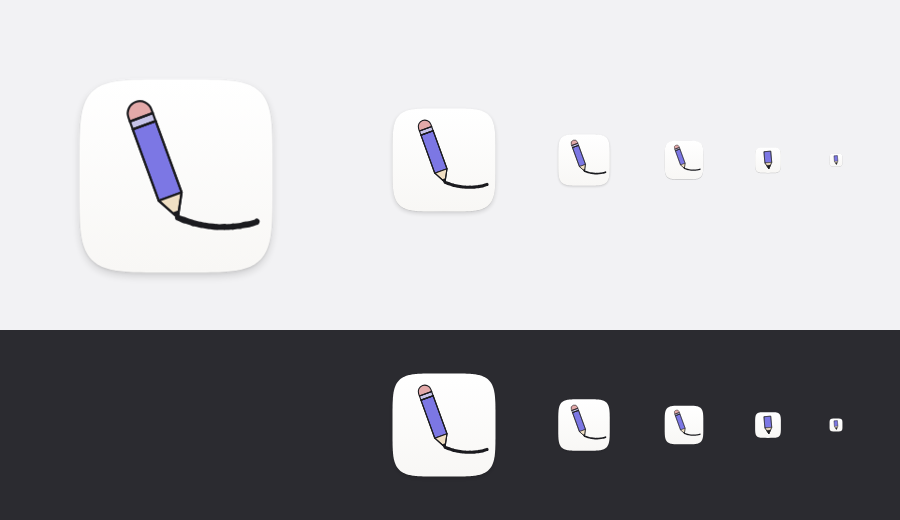

# App icon

> **Design record, not shipped.** This directory records an app-icon exploration
> that was reviewed and deliberately not adopted. `src-tauri/icons/` and
> `src-tauri/tauri.conf.json` are unchanged, and the application still ships the
> icon it had before this work. Nothing here affects the build.

The study is kept because the decisions and the measured properties are reusable:
the macOS icon grid, the two-master approach for 16/32 px, the curve work, and
the comparison renders.

## What the icon is

A pencil drawing the app's own page. A paper squircle carries a violet pencil and
the line it has just drawn; the line leaves the tip and sags under its own
weight. The reading is literal — this is a drawing app, and you draw — and it
holds up at Dock size in a way an abstract mark did not.



The full 1024 px render is in `icon-1024.png`.

## Specification

| Item                    | Value                                                                  |
| ----------------------- | ---------------------------------------------------------------------- |
| Canvas                  | 1024 × 1024, transparent outside the paper                             |
| Paper box               | 824 × 824, inset 100 px (macOS icon grid)                              |
| Paper shape             | superellipse, n = 5, continuous corner curvature                       |
| Shadow                  | baked: 15% blur 16 / +16 px, 10% blur 4 / +3 px                        |
| Paper                   | `#FFFFFF` → `#F8F7F5`                                                  |
| Ink                     | `#1B1B1F` (the app's `color.text.primary`), 9 px outline               |
| Pencil body             | `#7C77E4` (brand violet `#6965DB`, lifted for a light page)            |
| Cone / ferrule / eraser | `#F0DFC3` / `#C6C3E8` / `#E3A9A9`                                      |
| Pencil lean             | 20° from vertical, tip pointing down-right                             |
| Stroke                  | catenary on the tip→end chord, 30 px mid-span sag, 24 px wide          |
| Small master            | ≤ 32 px: upright, stubby, no line, no ferrule or eraser, 16 px outline |

The paper covers 82.8% of the canvas, which is the measured content box of Finder
and Notes at the same size.

## The decisions, and why

**Why a pencil, after an abstract mark.** The first direction was a hand-drawn
quadrilateral on paper — clean, brand-coloured, and rejected in review as too
abstract to enjoy. A pencil is the one object that says "drawing" without a
caption, and it survives being small far better than a shape outline does.

**Why the pencil leans left.** The lean is deliberate. The tip points down-right,
the direction the line travels, so the pencil's mass sits behind the line and the
two never cross; together they form an open V with the white space on the right.
Mirrored, the pencil leans right and the line runs leftwards, against Latin
reading direction, and the composition closes up
(`alternatives/mirror-master.svg`).

**Why a catenary, and not something fancier.** The line is the one place where
mathematics is visible, so it is a real curve rather than a hand-placed control
polygon: a catenary fitted to the chord between the tip and the end of the line,
with the mid-span sag solved to exactly 30 px (`a · (cosh(L/2a) − 1) = sag`),
then sampled and handed to the renderer as cubic Béziers. It is the shape a slack
line takes under its own weight, so the sag is the behaviour of a physical line
rather than an arbitrary bow.

A more elaborate curve — clothoid, spiral, spline flourish — would pull attention
to the mathematics and away from the pencil. The line has to read as something
just drawn; the catenary is the least arbitrary way to get that, and sampling it
as a polyline alone was not enough: rough.js roughens every joint into a visible
kink, which is why the sampler emits Bézier segments.

**Why 16 and 32 px are redrawn.** At 32 px the pencil is about 15 px tall. The
line, the ferrule and the eraser collapse into a black blob beside a violet one,
which is exactly what the first attempts produced. 16 and 32 px therefore use a
second master — upright, wider, no line, no ferrule, no eraser, heavier outline —
where the surviving information is the silhouette and the colour order violet /
cream / ink. This is the usual macOS practice: the 16 and 32 px slots are drawn
for their size, not downscaled. From 48 px upward the full drawing is used.

## Rejected along the way

| Attempt                                             | Why it failed                                                |
| --------------------------------------------------- | ------------------------------------------------------------ |
| Hand-drawn quadrilateral (direction A, `abstract/`) | Reviewed as too abstract; no reading beyond "a shape"        |
| Line as a plain cubic bow (`--variant bow`)         | Correct but arbitrary; the curve carried no meaning          |
| Mirrored composition (`--variant mirror`)           | Reads against Latin writing direction; composition closes up |
| Line running along the paper's inner edge           | Competed with the paper silhouette; read as a drawn border   |
| Line turning up into a hook at the end              | Read as a sickle, not a drawn line                           |
| Realistic pencil at true scale                      | 104 px wide body = 1.6 px at 16 px; invisible                |
| Detail (ferrule, eraser) kept below 48 px           | Turned into stripes and noise                                |

## Files

| Path                     | Purpose                                                    |
| ------------------------ | ---------------------------------------------------------- |
| `icon-master.svg`        | 1024 px source of truth for 48 px and above                |
| `icon-master-small.svg`  | source for the 16 and 32 px slots                          |
| `render-icon-pencil.mjs` | regenerates both masters and every delivery size           |
| `icon-1024.png`          | the finished 1024 px render                                |
| `preview.png`            | 256/128/64/48/32/16 at native size, light and dark         |
| `alternatives/`          | bow and mirror masters, plus `curve-comparison.png`        |
| `abstract/`              | superseded direction A, with its own generator and preview |
| `build/<variant>/`       | generated renders and `icon.icns` (ignored by Git)         |

Every size is rendered from the vector source; nothing is resampled from a
smaller bitmap.

## Regenerate

```sh
node docs/design/app-icon/render-icon-pencil.mjs                 # shipped study art
node docs/design/app-icon/render-icon-pencil.mjs --variant bow   # comparison only
```

Requires the locked project dependencies (`@playwright/test` for rendering,
`roughjs` from the Excalidraw dependency tree) and macOS `iconutil`.

## If it were ever adopted

The renders map onto the paths `src-tauri/tauri.conf.json` references. None of
these copies has been made:

| Output                        | Destination                      |
| ----------------------------- | -------------------------------- |
| `build/catenary/icon-512.png` | `src-tauri/icons/icon.png`       |
| `build/catenary/icon-128.png` | `src-tauri/icons/128x128.png`    |
| `build/catenary/icon-256.png` | `src-tauri/icons/128x128@2x.png` |
| `build/catenary/icon-32.png`  | `src-tauri/icons/32x32.png`      |
| `build/catenary/icon.icns`    | `src-tauri/icons/icon.icns`      |

## Known limits

- 16 px is a colour-and-silhouette signature only; no icon of this subject reads
  as a pencil at that size.
- The 9 px ink outline is heavier than the gradients and soft shadows system
  icons use, so the icon reads as an illustration rather than as a system icon.
  That is the intended character, not an accident, but it is a visible
  difference in the Dock.
- No macOS 26 icon variants (dark, tinted, clear) are produced. The study renders
  one appearance.
